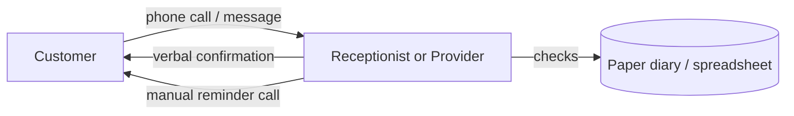
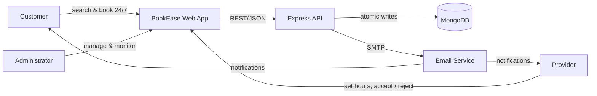

# Feasibility Study — BookEase Appointment Booking & Management System

| Item | Detail |
|---|---|
| Document | Feasibility Study (FS) |
| Version | 1.0 |
| Date | 30 October 2026 |
| Related documents | [SPMP](SPMP.md), [SRS](SRS.md) |

---

## 1. Introduction

### 1.1 Purpose
This study determines whether it is worthwhile and achievable to build **BookEase**, a web-based system that lets customers find service providers (doctors, dentists, trainers, stylists, lawyers, tutors, therapists), view live availability and book, reschedule or cancel appointments. Providers manage their working hours and bookings; administrators manage users, categories and system activity.

### 1.2 Problem statement
Small service businesses still schedule mostly by phone, messaging apps or paper diaries. This causes:

- **Double bookings**: two customers are given the same slot because the calendar isn't updated in real time.
- **Wasted time**: the provider or a receptionist spends hours a week on calls and messages.
- **No-shows and late cancellations**: there are no automatic confirmations or reminders.
- **No visibility**: customers can't see free slots outside business hours, and owners have no data about demand.

### 1.3 Scope of the study
The study covers technical, economic, operational, schedule and legal feasibility. It compares the existing and proposed systems, gives a cost–benefit analysis and lists the main risks.

---

## 2. Existing vs proposed system

### 2.1 Existing system (manual / semi-manual)

| Aspect | Existing system |
|---|---|
| Booking channel | Phone, WhatsApp, walk-in |
| Availability | Only known to the receptionist |
| Conflict control | Human memory, so double bookings happen |
| Confirmations | Verbal; nothing in writing |
| Rescheduling | Another call; often lost |
| Reporting | None, or a manual spreadsheet |
| Hours of operation | Business hours only |

### 2.2 Proposed system (BookEase)

| Aspect | Proposed system |
|---|---|
| Booking channel | Responsive web app (desktop and mobile) |
| Availability | Slots generated in real time from provider working hours |
| Conflict control | Server-side validation plus **partial unique indexes** in MongoDB (atomic) |
| Confirmations | In-app and email notifications at every status change |
| Rescheduling | Self-service, subject to a configurable change window |
| Reporting | Admin analytics dashboard and audit log |
| Hours of operation | 24/7 |

---

## 3. Technical feasibility

| Requirement | Chosen technology | Maturity / risk |
|---|---|---|
| Responsive UI | React 18, TypeScript, Tailwind CSS, Vite | Industry standard; low risk |
| REST API | Node.js 18+ / Express 4 | Mature, large ecosystem; low risk |
| Persistence | MongoDB 6+/7 with Mongoose 8 | Document model fits profiles and schedules; low risk |
| Authentication | JWT (jsonwebtoken) and bcrypt password hashing | Well understood; low risk |
| Authorisation | Role-based access control middleware | Simple to implement and test |
| Notifications | Nodemailer over SMTP | Works with any SMTP provider (Gmail, SendGrid, SES) |
| Double-booking prevention | Partial unique compound index `{provider, date, startTime}` where `isActive = true` | Enforced atomically by the database, even under concurrent requests |
| Testing | Jest, Supertest, mongodb-memory-server, Vitest | No external services needed in CI |

**Team skills.** The team knows JavaScript/TypeScript and has done coursework in web development and databases. The only new topics are MongoDB partial indexes and JWT, and both are well documented.

**Hardware.** Development runs on ordinary laptops. Production needs one small VM (1 vCPU / 1 GB RAM) or a PaaS, plus a managed MongoDB (for example, MongoDB Atlas free or shared tier).

**Conclusion:** technically **feasible**.

---

## 4. Economic feasibility

### 4.1 Development cost (estimate)
The team is made of students, so labour is valued at a notional market rate to show what the project would cost commercially.

| Item | Quantity | Unit cost (USD) | Total (USD) |
|---|---|---|---|
| Development effort (5 members × 10 weeks × 12 h/week) | 600 h | 15 | 9,000 |
| Software licences (all open source) | — | 0 | 0 |
| Development hardware (existing laptops) | — | 0 | 0 |
| Domain name (1 year) | 1 | 12 | 12 |
| **Total one-time cost** | | | **9,012** |

### 4.2 Operating cost (per year)

| Item | Monthly (USD) | Yearly (USD) |
|---|---|---|
| App hosting (small VM / PaaS) | 7 | 84 |
| MongoDB Atlas (shared M2) | 9 | 108 |
| Transactional email (≤ 10k/month, e.g. SendGrid Essentials) | 20 | 240 |
| Maintenance (4 h/month × $15) | 60 | 720 |
| **Total** | **96** | **1,152** |

### 4.3 Benefits (for a typical small clinic with one receptionist)

| Benefit | Assumption | Yearly value (USD) |
|---|---|---|
| Receptionist time saved | 8 h/week × 48 weeks × $12/h | 4,608 |
| Fewer no-shows (confirmations and easy cancellation) | 2 recovered appointments/week × $60 × 48 | 5,760 |
| Fewer double-booking incidents (refunds / goodwill) | 1 per month × $60 | 720 |
| Extra bookings from 24/7 availability | 1 per week × $60 × 48 | 2,880 |
| **Total yearly benefit (one business)** | | **13,968** |

### 4.4 Cost–benefit analysis

- **Net yearly benefit** = 13,968 − 1,152 = **$12,816** (per business)
- **Payback period** = 9,012 / 12,816 × 12 ≈ **8.4 months**
- **ROI (year 1)** = (13,968 − 1,152 − 9,012) / 9,012 ≈ **42 %**
- **3-year NPV** at 10 % discount rate:
  NPV = −9,012 + 12,816/1.1 + 12,816/1.21 + 12,816/1.331 ≈ **$22,860**

The platform is multi-tenant, so each additional business increases the benefit with almost no extra cost.

**Conclusion:** economically **feasible**, with a positive NPV and payback in under a year.

---

## 5. Operational feasibility

| Stakeholder | Change required | Acceptance |
|---|---|---|
| Customers | Book online instead of calling | High: self-service, 24/7, works on mobile |
| Providers | Enter working hours once; respond to requests | High: removes phone work; dashboard shows today's agenda |
| Administrator | Approve providers, maintain categories | Medium effort, simple UI |

- Each role's tasks fit on one or two screens, with role-based navigation.
- Seeded demo accounts let users try the system before adopting it.
- The system fails safely: if email delivery fails, the booking still succeeds and the in-app notification records the email status.

**Conclusion:** operationally **feasible**.

---

## 6. Schedule feasibility

The project fits a 10-week academic term using 2-week Scrum sprints. The detailed plan is in the [SPMP](SPMP.md#7-project-timeline--gantt-chart).

| Phase | Weeks |
|---|---|
| Inception: feasibility, SPMP, SRS | 1–2 |
| Design: DFD, UML, ER, architecture | 2–3 |
| Backend and database | 3–6 |
| Frontend and integration | 5–8 |
| Testing and hardening | 8–9 |
| Documentation update and delivery | 10 |

There is about one week of slack, so a single sprint slipping does not threaten delivery.

**Conclusion:** **feasible** within the term.

---

## 7. Legal feasibility

| Concern | Mitigation in BookEase |
|---|---|
| Personal data protection (GDPR / India DPDP Act 2023 / local law) | Stores only the data needed: name, email, phone, appointments. Users can edit their details, and admins can delete accounts that have no history. |
| Password security | bcrypt hashing (cost 10); passwords are never returned by the API |
| Health data sensitivity (e.g. HIPAA when used by clinics) | Notes are optional and free text. Production deployments for healthcare should add encryption at rest and a Business Associate Agreement with the hosting provider. |
| Email (CAN-SPAM / anti-spam) | Only transactional emails, triggered by the user's own actions |
| Open-source licences | All dependencies are MIT/Apache-2.0/BSD/ISC, which allow commercial use |
| Terms of service | Required before public launch; outside academic scope |

**Conclusion:** legally **feasible**, provided healthcare deployments add the extra safeguards above.

---

## 8. Risks

| # | Risk | Probability | Impact | Mitigation |
|---|---|---|---|---|
| R1 | Race conditions cause double bookings | Medium | High | Partial unique indexes and conditional updates; covered by concurrency test IT-13 |
| R2 | Email provider outage | Medium | Low | Fire-and-forget delivery; in-app notifications remain the source of truth |
| R3 | Scope creep (payments, SMS, video calls) | High | Medium | Fixed product backlog; extras listed as future work |
| R4 | Team member unavailable | Medium | Medium | Pair programming; documented code; shared repository |
| R5 | Time-zone confusion | Low | Medium | Single-time-zone deployment assumption, documented in the SRS |
| R6 | Security vulnerabilities (injection, broken auth) | Medium | High | zod validation, regex escaping, Helmet, rate limiting, RBAC tests |

The full risk register is in the [SPMP](SPMP.md#10-risk-management).

---

## 9. Conclusion and recommendation

| Dimension | Verdict |
|---|---|
| Technical | Feasible |
| Economic | Feasible: payback ≈ 8 months, 3-year NPV ≈ $22.9k |
| Operational | Feasible |
| Schedule | Feasible within a 10-week term |
| Legal | Feasible, with extra safeguards for healthcare deployments |

**Recommendation:** proceed with development of BookEase using the MERN + TypeScript stack, following the plan in the SPMP.
