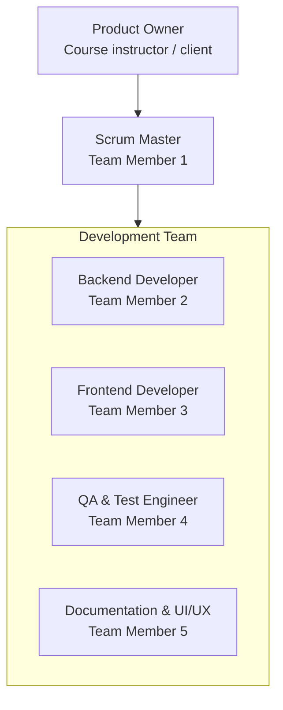
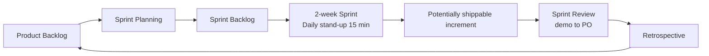
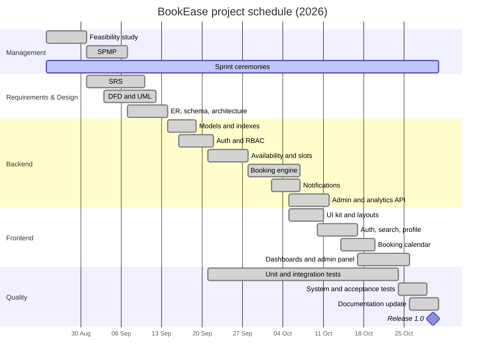

# Software Project Management Plan (SPMP) — BookEase

*Structure based on IEEE Std 1058-1998 (Software Project Management Plans).*

| Item | Detail |
|---|---|
| Version | 1.0 |
| Date | 30 October 2026 |
| Project duration | 10 weeks (24 Aug 2026 – 30 Oct 2026) |
| Methodology | Agile / Scrum, 2-week sprints |

---

## 1. Overview

### 1.1 Purpose, scope and objectives
**Purpose.** This plan describes how the BookEase Appointment Booking & Management System will be planned, built, tested, controlled and delivered.

**Scope.** In scope:
- A responsive web application for three roles (Customer, Service Provider, Administrator)
- A REST API with JWT authentication and role-based access control
- MongoDB persistence with atomic double-booking prevention
- Email and in-app notifications
- A full set of software engineering documents (FS, SPMP, SRS, DFD, UML, DSA, architecture, database, API, testing)

**Out of scope:** online payments, SMS/WhatsApp messaging, video consultation, native mobile apps, multi-time-zone scheduling.

**Objectives**

| ID | Objective | Measure |
|---|---|---|
| O1 | Zero double bookings | Concurrency test: 10 parallel requests for one slot produce exactly 1 booking |
| O2 | Book an appointment in at most 3 interactions after opening a provider page | Pick date, pick slot, request booking |
| O3 | API p95 latency < 300 ms for typical requests | Measured locally with the seeded data set |
| O4 | ≥ 40 automated tests covering every functional requirement area | Jest and Vitest reports |
| O5 | Documentation consistent with the code | Final review checklist (§ 12) |

### 1.2 Project deliverables

| # | Deliverable | Format | Due |
|---|---|---|---|
| D1 | Feasibility Study | `docs/Feasibility_Study.md` | Week 1 |
| D2 | SPMP | `docs/SPMP.md` | Week 2 |
| D3 | SRS | `docs/SRS.md` | Week 2 |
| D4 | Design documents (DFD, UML, ER, architecture) | `docs/*.md` (Mermaid) | Week 3 |
| D5 | Backend API and database | `backend/` | Week 6 |
| D6 | Frontend application | `frontend/` | Week 8 |
| D7 | Test suites and testing document | `backend/tests`, `frontend/src/__tests__`, `docs/Testing_Documentation.md` | Week 9 |
| D8 | Final release, README, updated documentation | Repository | Week 10 |

---

## 2. Project organisation

### 2.1 Team organisation (Scrum)

### 2.2 Roles and responsibilities (RACI)

| Activity | PO | SM | Backend | Frontend | QA | Docs |
|---|---|---|---|---|---|---|
| Requirements / backlog | **A** | R | C | C | C | R |
| Architecture & design | C | A | **R** | R | C | R |
| Backend & database | I | A | **R** | C | C | I |
| Frontend | I | A | C | **R** | C | C |
| Testing | I | A | R | R | **R** | I |
| Documentation | C | A | C | C | C | **R** |
| Release | **A** | R | R | R | R | R |

R = Responsible, A = Accountable, C = Consulted, I = Informed.

---

## 3. Process model: Agile / Scrum

| Ceremony | Frequency | Time-box | Output |
|---|---|---|---|
| Sprint planning | Start of each sprint | 1 h | Sprint goal and sprint backlog |
| Daily stand-up | Each working day (online) | 15 min | Blockers raised |
| Sprint review | End of sprint | 45 min | Demo; backlog updated |
| Retrospective | End of sprint | 30 min | Improvement actions |
| Backlog refinement | Mid-sprint | 30 min | Estimated, ready stories |

**Definition of Done:** code is reviewed and merged to `main`; lint and type checks pass; automated tests are added and passing; the feature has been demonstrated in the UI; the related documentation is updated.

**Estimation:** story points (Fibonacci). Velocity was measured after sprint 1, at about 26 points per sprint.

### 3.1 Sprint plan

| Sprint | Dates | Goal | Key stories |
|---|---|---|---|
| 0 | 24 Aug – 30 Aug | Inception | Feasibility study, tooling, repository, initial backlog |
| 1 | 31 Aug – 13 Sep | Requirements and design | SRS, DFD, UML, ER, architecture |
| 2 | 14 Sep – 27 Sep | Core backend | Models, auth, RBAC, availability, slot generation |
| 3 | 28 Sep – 11 Oct | Booking engine and admin API | Booking, cancel, reschedule, status machine, notifications, admin endpoints |
| 4 | 12 Oct – 25 Oct | Frontend and integration | All pages, booking calendar, dashboards, responsive design |
| 5 | 26 Oct – 30 Oct | Hardening and release | System and acceptance tests, bug fixes, documentation update |

---

## 4. Work Breakdown Structure (WBS)

```mermaid
flowchart TD
    P[1 BookEase Project]
    P --> A[1.1 Project Management]
    P --> B[1.2 Requirements]
    P --> C[1.3 Design]
    P --> D[1.4 Backend]
    P --> E[1.5 Frontend]
    P --> F[1.6 Testing]
    P --> G[1.7 Deployment & Docs]

    A --> A1[1.1.1 Feasibility study]
    A --> A2[1.1.2 SPMP]
    A --> A3[1.1.3 Sprint ceremonies]

    B --> B1[1.2.1 Stakeholder analysis]
    B --> B2[1.2.2 SRS]
    B --> B3[1.2.3 Use cases]

    C --> C1[1.3.1 DFD L0-L2]
    C --> C2[1.3.2 UML class / object]
    C --> C3[1.3.3 ER & schema]
    C --> C4[1.3.4 Architecture & API design]

    D --> D1[1.4.1 Models & indexes]
    D --> D2[1.4.2 Auth & RBAC]
    D --> D3[1.4.3 Provider & availability API]
    D --> D4[1.4.4 Booking engine]
    D --> D5[1.4.5 Notifications]
    D --> D6[1.4.6 Admin & analytics API]
    D --> D7[1.4.7 Seed data]

    E --> E1[1.5.1 UI kit & layout]
    E --> E2[1.5.2 Auth pages]
    E --> E3[1.5.3 Search & profile]
    E --> E4[1.5.4 Booking calendar]
    E --> E5[1.5.5 Role dashboards]
    E --> E6[1.5.6 Admin panel]

    F --> F1[1.6.1 Unit tests]
    F --> F2[1.6.2 Integration tests]
    F --> F3[1.6.3 System E2E tests]
    F --> F4[1.6.4 Acceptance tests]

    G --> G1[1.7.1 README & setup]
    G --> G2[1.7.2 Final documentation]
    G --> G3[1.7.3 Release]
```

### 4.1 WBS dictionary (effort)

| WBS | Work package | Effort (h) | Owner |
|---|---|---|---|
| 1.1 | Project management | 40 | Scrum Master |
| 1.2 | Requirements | 50 | Docs, SM |
| 1.3 | Design | 70 | Backend, Docs |
| 1.4 | Backend | 150 | Backend |
| 1.5 | Frontend | 160 | Frontend |
| 1.6 | Testing | 80 | QA |
| 1.7 | Deployment & documentation | 50 | Docs |
| | **Total** | **600** | |

---

## 5. Resource and cost estimation

### 5.1 Size
Measured size of the finished system:

| Component | Files | Lines of code |
|---|---|---|
| Backend source (`backend/src`) | 33 | ≈ 2,650 |
| Backend tests | 5 | ≈ 570 |
| Frontend source (`frontend/src`) | 62 | ≈ 4,900 |
| **Total** | | **≈ 8.1 KLOC** |

### 5.2 Basic COCOMO (organic mode)

- Effort E = 2.4 × (KLOC)^1.05 = 2.4 × 8.1^1.05 ≈ **21.6 person-months**
- Development time T = 2.5 × E^0.38 = 2.5 × 21.6^0.38 ≈ **8.0 months**
- Average staffing = E / T ≈ **2.7 people**

**Interpretation.** COCOMO was calibrated on projects written without modern frameworks. BookEase reuses a lot (React, Express, Mongoose, Tailwind, zod), so the actual plan is **600 person-hours ≈ 3.75 person-months** (5 members × 12 h/week × 10 weeks). The gap is the expected effect of framework reuse; COCOMO II's reuse and tool factors would close most of it.

### 5.3 Resources

| Resource | Details |
|---|---|
| Human | 5 members, part-time (≈ 12 h/week each) |
| Hardware | Personal laptops (8 GB+ RAM) |nline payments, SMS/WhatsApp messaging, video consultation, native mobile apps, multi-time-zone scheduling.

| Software | Node.js 18+, MongoDB 7 / Atlas, VS Code, Git, Chrome |
| Services | GitHub (version control), SMTP account (e.g. Gmail app password or Mailtrap) |

### 5.4 Cost
See [Feasibility Study § 4](Feasibility_Study.md#4-economic-feasibility): one-time ≈ **$9,012**, operating ≈ **$1,152 per year**.

---

## 6. Schedule: milestones

| Milestone | Date | Exit criteria |
|---|---|---|
| M1 Project approved | 30 Aug 2026 | Feasibility study accepted |
| M2 Requirements baseline | 13 Sep 2026 | SRS reviewed and signed off |
| M3 Design baseline | 13 Sep 2026 | DFD, UML, ER approved |
| M4 API feature-complete | 11 Oct 2026 | All endpoints implemented; integration tests green |
| M5 UI feature-complete | 25 Oct 2026 | All pages integrated |
| M6 Release 1.0 | 30 Oct 2026 | All tests pass; documentation updated |

---

## 7. Project timeline & Gantt chart

---

## 8. Monitoring and control

| Mechanism | Purpose |
|---|---|
| Sprint burndown chart | Daily progress against sprint scope |
| Velocity tracking | Forecast remaining sprints |
| GitHub Issues / project board | Backlog, *To do → In progress → Review → Done* |
| Pull-request reviews | Quality gate before merging |
| Weekly status note to the Product Owner | Progress, risks, decisions |

---

## 9. Quality management

| Practice | Standard / tool |
|---|---|
| Coding standard | Consistent naming, small modules (routes → controllers → services → models), TypeScript `strict` on the frontend |
| Input validation | Every request body and query validated with zod schemas (`backend/src/utils/validators.js`) |
| Code review | At least one reviewer per pull request |
| Automated testing | Jest + Supertest (44 backend tests), Vitest (7 frontend tests), Playwright E2E script (19 flows) |
| Static checking | `tsc --noEmit` on every build |
| Defect tracking | GitHub Issues with severity labels (S1 critical … S4 cosmetic) |
| Acceptance | Acceptance criteria in SRS § 9, verified in [Testing_Documentation.md](Testing_Documentation.md) |

**Quality metrics targets:** 0 open S1/S2 defects at release; 100 % of functional requirements traced to at least one test; build and type check pass.

---

## 10. Risk management

Process: *identify → analyse (probability × impact) → plan → monitor*, reviewed in every retrospective.

| ID | Risk | P (1–5) | I (1–5) | Score | Response | Owner | Status |
|---|---|---|---|---|---|---|---|
| R1 | Concurrent requests create double bookings | 3 | 5 | 15 | **Mitigate**: partial unique indexes, conditional updates, concurrency test | Backend | Closed (IT-13 passes) |
| R2 | Requirements change late | 3 | 3 | 9 | **Mitigate**: fixed sprint scope; changes go to the backlog | PO / SM | Monitored |
| R3 | Team member unavailable | 2 | 4 | 8 | **Mitigate**: pair programming, shared knowledge, documentation | SM | Monitored |
| R4 | MongoDB not installed on demo machine | 3 | 3 | 9 | **Avoid**: built-in in-memory MongoDB mode with auto-seed | Backend | Closed |
| R5 | SMTP credentials unavailable | 4 | 2 | 8 | **Accept / mitigate**: dev mode logs emails; in-app notifications always work | Backend | Closed |
| R6 | Security flaw (auth bypass, injection) | 2 | 5 | 10 | **Mitigate**: zod validation, regex escaping, Helmet, rate limiting, RBAC tests | QA | Monitored |
| R7 | UI not usable on mobile | 2 | 3 | 6 | **Mitigate**: mobile-first Tailwind; 390 px viewport E2E check | Frontend | Closed |
| R8 | Schedule overrun | 2 | 4 | 8 | **Mitigate**: one week of buffer; MoSCoW prioritisation | SM | Closed |

---

## 11. Configuration management

| Item | Practice |
|---|---|
| Version control | Git; one repository (`frontend/`, `backend/`, `docs/`) |
| Branching | `main` (always releasable) ← `feature/<issue-id>-<slug>` via pull request |
| Commit convention | Conventional Commits (`feat:`, `fix:`, `docs:`, `test:`, `refactor:`) |
| Versioning | Semantic Versioning; release 1.0.0 tagged `v1.0.0` |
| Configuration items | Source code, `package.json` / lock files, `.env.example`, documentation, test suites, seed data |
| Environment configuration | `.env` files (never committed; `.gitignore`), template in `.env.example` |
| Baselines | Requirements (M2), Design (M3), Release (M6) |
| Change control | Change request as GitHub Issue → impact analysis → PO approval → backlog |

---

## 12. Documentation consistency checklist (release gate)

- [x] Every API endpoint in `backend/src/routes/index.js` appears in [API_Documentation.md](API_Documentation.md)
- [x] Every Mongoose model and field appears in [Database_Design.md](Database_Design.md) and [UML_Class_Diagram.md](UML_Class_Diagram.md)
- [x] Algorithms in [Data_Structures_Algorithms.md](Data_Structures_Algorithms.md) match `backend/src/algorithms/*`
- [x] Test IDs in [Testing_Documentation.md](Testing_Documentation.md) match the test files
- [x] Every functional requirement (FR-xx) is traced to a test
