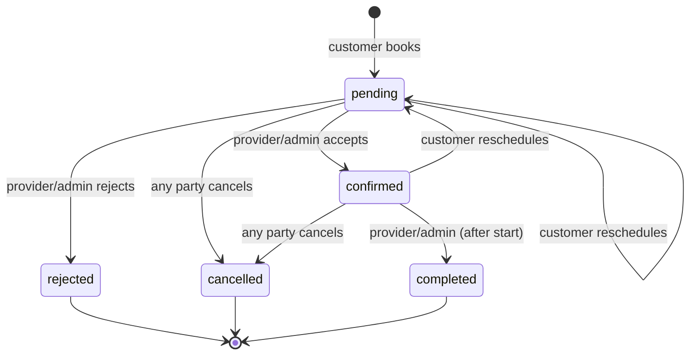

# Software Requirements Specification (SRS) — BookEase

*Structure based on IEEE Std 830-1998 / ISO/IEC/IEEE 29148:2018.*

| Item | Detail |
|---|---|
| Version | 1.0 (baseline updated to match release 1.0) |
| Date | 30 October 2026 |
| Status | Approved |

---

## 1. Introduction

### 1.1 Purpose
This document specifies the functional and non-functional requirements of **BookEase**, a web-based Appointment Booking & Management System. It is written for the development team, testers, the course instructor (product owner) and future maintainers.

### 1.2 Scope
BookEase lets **customers** find service providers and book, reschedule or cancel appointments in real time. **Service providers** publish profiles, working hours and days off, and accept, reject or complete bookings. **Administrators** manage users, provider approvals, categories and appointments, and monitor analytics and an audit log. The system sends **email** and **in-app notifications**, and guarantees that **one slot can never be booked twice**.

### 1.3 Definitions, acronyms and abbreviations

| Term | Definition |
|---|---|
| Slot | A bookable time interval `[start, end)` produced from a provider's working hours |
| Active appointment | An appointment with status `pending` or `confirmed`; it holds its slot |
| Change window | The minimum time before the start (default 2 h) after which a customer can no longer cancel or reschedule |
| Booking horizon | How far ahead bookings are accepted (default 60 days) |
| Buffer | Gap in minutes inserted after every slot |
| JWT | JSON Web Token, a signed bearer token used for authentication |
| RBAC | Role-Based Access Control |
| API | Application Programming Interface (REST over HTTP/JSON) |
| SPA | Single-Page Application |
| E11000 | MongoDB duplicate-key error code |

### 1.4 References
- IEEE Std 830-1998, *Recommended Practice for Software Requirements Specifications*
- [Feasibility Study](Feasibility_Study.md), [SPMP](SPMP.md), [API Documentation](API_Documentation.md), [Database Design](Database_Design.md)

### 1.5 Overview
Section 2 describes the product. Section 3 lists the functional requirements. Sections 4–8 cover non-functional requirements, external interfaces, constraints, security and performance. Section 9 gives the acceptance criteria.

---

## 2. Overall description

### 2.1 Product perspective
BookEase is a new, self-contained system with a three-tier architecture: React SPA → Express REST API → MongoDB. It also connects to an external SMTP server. See [System_Architecture.md](System_Architecture.md).

### 2.2 Product functions (summary)
1. Account registration, login and profile management
2. Provider search, filtering and profile viewing
3. Real-time slot generation and booking
4. Cancellation, rescheduling, reviews
5. Provider schedule and booking management
6. Notifications (email + in-app)
7. Administration, analytics and audit log

### 2.3 User classes and characteristics

| Role | Description | Technical skill | Frequency |
|---|---|---|---|
| Customer | Books services | Basic web user | Occasional |
| Service Provider | Professional offering appointments | Basic | Daily |
| Administrator | Platform operator | Intermediate | Daily |
| Email Service (external actor) | SMTP server that delivers notifications | n/a | Event driven |

### 2.4 Operating environment
- **Client:** current Chrome, Edge, Firefox or Safari on desktop or mobile (≥ 360 px wide)
- **Server:** Node.js ≥ 18, MongoDB ≥ 6 (or the bundled in-memory MongoDB for demos)
- **OS:** any OS supported by Node.js (Linux, Windows, macOS)

### 2.5 Design and implementation constraints
- Stack fixed by the client: React + TypeScript + Tailwind, Node.js + Express, MongoDB + Mongoose, JWT, Nodemailer.
- Single time zone: all dates and times are interpreted in the server's local time zone.
- REST/JSON only; no WebSockets (notifications are polled every 60 s).

### 2.6 Assumptions and dependencies
- Users have a valid email address.
- An SMTP account is available for real email delivery; otherwise emails are rendered and logged (development mode).
- Payment happens at the appointment (outside the system).

---

## 3. Functional requirements

Priority uses MoSCoW: **M** = Must, **S** = Should, **C** = Could.

### 3.1 Authentication & accounts

| ID | Requirement | Priority |
|---|---|---|
| FR-01 | The system shall let a visitor register as a **customer** or **service provider** with name, email, password and optional phone. Providers must also give a category and specialization; they may give a city and price. | M |
| FR-02 | The system shall reject registration when the email already exists, the password is under 8 characters, or it lacks a letter and a digit. Self-registration as administrator shall not be possible. | M |
| FR-03 | The system shall authenticate users by email and password and issue a signed JWT that expires (default 7 days). | M |
| FR-04 | The system shall let an authenticated user view and update their name and phone, and change their password after confirming the current one. | M |
| FR-05 | The system shall enforce role-based access on every protected endpoint and page (customer / provider / admin). | M |
| FR-06 | The system shall prevent deactivated accounts from logging in or using an existing token. | M |

### 3.2 Provider discovery

| ID | Requirement | Priority |
|---|---|---|
| FR-07 | The system shall let anyone search **approved, active** providers by free text (name, specialization, category, tags, city, bio) and filter by category, city, maximum price and minimum rating. | M |
| FR-08 | The system shall sort search results by relevance, rating, price (ascending or descending), experience or name, and paginate them. | S |
| FR-09 | The system shall show a provider profile with bio, contact details, price, weekly working hours, rating and recent reviews. | M |
| FR-10 | The system shall return the slot list for a provider and date, marking each slot as `available`, `booked` or `past`. It shall return no slots for past dates, days off, blocked dates or dates beyond the booking horizon. | M |

### 3.3 Booking management (customer)

| ID | Requirement | Priority |
|---|---|---|
| FR-11 | A customer shall be able to request a booking for an available slot, with optional notes. The appointment is created with status `pending`. | M |
| FR-12 | The system shall **prevent double booking**: at most one active appointment may exist per provider, date and start time, even under concurrent requests. | M |
| FR-13 | The system shall prevent a customer from holding two active appointments whose times overlap, including with different providers. | M |
| FR-14 | The server shall validate that the requested start time is one of the provider's generated slots, is not in the past, and is within the booking horizon. | M |
| FR-15 | A customer shall be able to cancel an active appointment, with an optional reason, up to the change window before it starts. The slot becomes available again. | M |
| FR-16 | A customer shall be able to reschedule an active appointment to another available slot (at most 3 times). The appointment returns to `pending` and the old slot is released atomically. | M |
| FR-17 | A customer shall be able to view their booking history, filtered by upcoming, past, cancelled/declined or all, and paginated. | M |
| FR-18 | A customer shall be able to rate (1–5) and review each completed appointment once. The provider's average rating is updated. | S |

### 3.4 Provider management

| ID | Requirement | Priority |
|---|---|---|
| FR-19 | A provider shall be able to edit their public profile (category, specialization, bio, experience, city, address, price, keyword tags). | M |
| FR-20 | A provider shall be able to set, for each weekday, whether they work, start and end times, and an optional break, plus a slot duration (10–240 min) and buffer (0–120 min). | M |
| FR-21 | A provider shall be able to block specific dates (holidays). Blocked dates offer no slots. | M |
| FR-22 | A provider shall be able to **accept** (confirm) or **reject** pending requests, with an optional reason. | M |
| FR-23 | A provider shall be able to cancel confirmed appointments and mark appointments **completed** once they have started. | M |
| FR-24 | A provider shall see a dashboard with status counts, pending requests and today's schedule. | S |

### 3.5 Notifications

| ID | Requirement | Priority |
|---|---|---|
| FR-25 | The system shall create an in-app notification and send an email for: registration (welcome), booking request (to customer and provider), confirmation, rejection, cancellation (to the other party), reschedule, completion, account (de)activation and provider approval. | M |
| FR-26 | A failure to send an email shall not fail the business operation; the email outcome (`sent`, `failed`, `skipped`) shall be stored on the notification. | M |
| FR-27 | A user shall be able to list notifications, see the unread count, and mark one or all as read. | S |

### 3.6 Administration

| ID | Requirement | Priority |
|---|---|---|
| FR-28 | An administrator shall be able to list and search customers and providers, edit name/phone, deactivate or reactivate accounts, and delete accounts that have no appointment history. | M |
| FR-29 | An administrator shall be able to approve providers, or hide them from search. | M |
| FR-30 | An administrator shall be able to create, edit, hide and delete categories. Deleting a category used by providers shall be refused. | M |
| FR-31 | An administrator shall be able to view and filter all appointments (status, date range, party name) and confirm, complete or cancel them. | M |
| FR-32 | An administrator shall see analytics: users by role, pending approvals, appointments by status, bookings over the last 14 days, bookings by category, top providers, completed revenue. | S |
| FR-33 | The system shall record an audit log entry for significant actions (registration, login, booking changes, profile/availability updates, admin actions), visible to administrators. | S |

### 3.7 Appointment state machine

---

## 4. Non-functional requirements

| ID | Category | Requirement |
|---|---|---|
| NFR-01 | Performance | 95 % of API requests complete in < 300 ms with ≤ 10,000 appointments on reference hardware (4-core laptop). |
| NFR-02 | Scalability | The API is stateless (JWT), so it can be scaled horizontally behind a load balancer. |
| NFR-03 | Availability | Target 99.5 % monthly uptime in production. |
| NFR-04 | Reliability | No double bookings under concurrent load (verified by test IT-13). |
| NFR-05 | Usability | A new customer can complete a booking in under 2 minutes without help. Every action gives visible feedback (loading state, toast, error message). |
| NFR-06 | Responsiveness | All pages usable from 360 px to 1920 px wide with no horizontal scrolling. |
| NFR-07 | Accessibility | Semantic HTML, labelled form controls, keyboard-focusable controls, ARIA attributes on dialogs, tabs and menus; aiming for WCAG 2.1 AA colour contrast. |
| NFR-08 | Maintainability | Layered architecture (routes → controllers → services → models); algorithms isolated in `backend/src/algorithms` with unit tests. |
| NFR-09 | Portability | Runs on Linux, Windows and macOS; zero-install demo mode with in-memory MongoDB. |
| NFR-10 | Testability | ≥ 40 automated tests; the test DB runs in memory, so no external services are needed. |

---

## 5. External interface requirements

### 5.1 User interfaces

| Page | Route | Role |
|---|---|---|
| Landing | `/` | Public |
| Login / Registration | `/login`, `/register` | Guest |
| Provider search | `/providers` | Public |
| Provider profile + booking calendar | `/providers/:id` | Public (booking: customer) |
| Customer dashboard | `/customer` | Customer |
| Appointment history | `/customer/appointments` | Customer |
| Provider dashboard | `/provider` | Provider |
| Provider appointments | `/provider/appointments` | Provider |
| Availability management | `/provider/availability` | Provider |
| Provider public profile editor | `/provider/profile` | Provider |
| Admin analytics dashboard | `/admin` | Admin |
| Admin management panel | `/admin/manage?tab=customers\|providers\|categories\|appointments\|activity` | Admin |
| Notifications | `/notifications` | Authenticated |
| Account settings | `/account` | Authenticated |

### 5.2 Software interfaces
- **REST API** under `/api`, JSON request and response bodies. See [API_Documentation.md](API_Documentation.md).
- **MongoDB** through the Mongoose ODM.
- **SMTP** through Nodemailer (`SMTP_HOST`, `SMTP_PORT`, `SMTP_USER`, `SMTP_PASS`).

### 5.3 Communication interfaces
HTTPS in production; HTTP on localhost during development. Data format: UTF-8 JSON. Authentication: `Authorization: Bearer <JWT>` header.

### 5.4 Hardware interfaces
None beyond standard client and server hardware.

---

## 6. Constraints
- Times use a 24 h `HH:mm` format; dates use `YYYY-MM-DD`; single time zone.
- Slot duration 10–240 min; buffer 0–120 min; at most 100 blocked dates; at most 10 tags per provider.
- Request bodies are limited to 100 KB.
- Only open-source dependencies.

---

## 7. Security requirements

| ID | Requirement | Implementation |
|---|---|---|
| SR-01 | Passwords are stored only as salted hashes | bcrypt (cost 10), `select: false` on the password field |
| SR-02 | Every protected request carries a valid, unexpired JWT | `authenticate` middleware; account is re-checked on every request |
| SR-03 | Users can access only their own appointments | Ownership check in `loadOwnedAppointment`; returns 404 to non-owners |
| SR-04 | All input is validated and normalised | zod schemas for body, query and params |
| SR-05 | No NoSQL or regex injection | Typed zod parsing (objects rejected where strings are expected); user text escaped before building regexes |
| SR-06 | Brute-force protection | Rate limit of 50 requests per 15 min on `/auth/register` and `/auth/login` |
| SR-07 | Secure HTTP headers | Helmet; CORS restricted to `CLIENT_URL` |
| SR-08 | Secrets are kept out of source control | `.env` is git-ignored; production refuses to start with the default JWT secret |
| SR-09 | Admin accounts cannot be self-registered or deleted | Registration schema allows only `customer`/`provider`; delete guard |

---

## 8. Performance requirements
- Slot generation for one day: O(S + B log B), well under 5 ms for typical days (S ≤ 100 slots).
- Indexed queries: `{provider, date, startTime}`, `{customer, date}`, `{provider, date, status}`, `{createdAt}`.
- Search over ≤ 1,000 providers responds in < 200 ms.
- The frontend is code-split per page (lazy routes); the initial JS bundle is about 74 KB gzipped.

---

## 9. Acceptance criteria

| AC | Criterion | Verified by |
|---|---|---|
| AC-01 | A customer can register, log in, find a dentist, book a free slot and see it under *Upcoming* as **Pending** | E2E flows 2–4 |
| AC-02 | When 10 customers request the same slot at the same moment, exactly 1 succeeds and 9 receive **409 SLOT_TAKEN** | IT-13 |
| AC-03 | A booked slot is shown as unavailable to other customers; once cancelled, it becomes available again | IT-11, IT-17 |
| AC-04 | A provider can accept or reject requests and the customer receives a notification | IT-17, IT-18, E2E 9 |
| AC-05 | A customer can reschedule to another free slot; the old slot is freed and the status returns to Pending | IT-20, E2E 5 |
| AC-06 | Cancellation within 2 h of the start is refused for customers but allowed for providers | IT-22 |
| AC-07 | Providers' changes to working hours and blocked dates are reflected immediately in the slots offered | IT-10, IT-25 |
| AC-08 | An admin can approve a pending provider, who then appears in search | IT-28, E2E 14 |
| AC-09 | Customers and providers cannot reach admin endpoints (403) or other roles' pages (redirect) | IT-07, E2E 18 |
| AC-10 | All pages render without horizontal scrolling at 390 px wide | E2E mobile check |
| AC-11 | Every automated test passes (`npm test`) | CI / local run |

---

## 10. Requirements traceability (summary)

| FR | Design element | Code | Test |
|---|---|---|---|
| FR-01–02 | Auth use case, User/ProviderProfile classes | `authController.register`, `validators.register` | IT-01–04 |
| FR-03, FR-06 | Login sequence | `authController.login`, `middleware/auth.js` | IT-05, IT-06 |
| FR-04 | — | `updateAccount`, `changePassword` | IT-08 |
| FR-05 | RBAC | `authorize()` | IT-07, IT-29 |
| FR-07–08 | Search algorithm | `providerController.search`, `algorithms/providerSearch.js` | UT-09–11, IT-26 |
| FR-09 | — | `providerController.getProvider` | IT-27 |
| FR-10 | Slot generation algorithm | `bookingService.computeSlots`, `algorithms/slotGenerator.js` | UT-05–07, IT-09, IT-10 |
| FR-11–14 | Booking workflow (DFD L2) | `bookingService.createAppointment`, `assertSlotBookable` | IT-11–16 |
| FR-15–16 | State machine | `changeStatus`, `rescheduleAppointment` | IT-17, IT-20–22 |
| FR-17 | Sorting algorithm | `appointmentController.list` | IT-24 |
| FR-18 | Rating update | `reviewAppointment`, `ProviderProfile.applyRating` | IT-19 |
| FR-19–21 | Availability class | `providerController.update*` | IT-25 |
| FR-22–24 | State machine | `changeStatus`, `appointmentController.summary` | IT-17–19, IT-24 |
| FR-25–27 | Notification service | `notificationService.notify`, `notificationController` | IT-01, IT-11, IT-32 |
| FR-28–33 | Admin use cases | `adminController`, `categoryController` | IT-28–31 |
